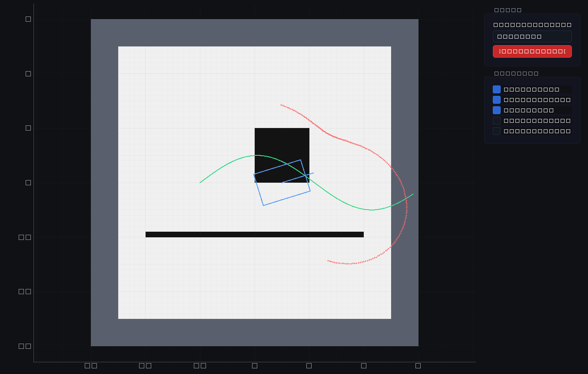

# RCS — Robot Control System

Desktop operator console for Hinson-class differential-drive AMRs. Runs on
**Windows and Linux** as a self-contained app: **no ROS 2 and no Python
needed on the operator PC**.

The robot runs `rosbridge_server` (port 9090); the app connects to it over
WebSocket.

**→ [Download](https://github.com/b4lanc3/AMR-RCS/releases/latest)**
&nbsp;·&nbsp; **→ [User guide](docs/USER_GUIDE.md)**



## Features

- **Robots:** profiles with address, topic and frame names and speed limits;
  auto-reconnect.
- **Robot programs:** start and stop bringup and Nav2 on the robot from the
  app, on a saved map or building a new one with SLAM; save maps. No
  terminal on the robot.
- **Teleop:** on-screen joystick or keyboard (W/A/S/D, arrows), with speed
  limits. Publishes only while you drive, so it never blocks Nav2.
- **Software E-STOP:** cancels the Nav2 goal and the mission, streams zero
  velocity and publishes `/amr/estop` ([limits](#safety-notes)).
- **2D map:** occupancy grid, lidar points (aligned through `/tf_static`),
  robot footprint, planned path, global/local costmaps. Click to set the
  initial pose, send a goal (position + heading) or add waypoints.
- **Navigation:** live Nav2 state (pending, navigating, reached, canceled,
  aborted, no response), distance and time remaining, cancel.
- **Missions:** ordered waypoints (checkpoints) with tolerance and dwell,
  loop routes, play / pause / stop; automatic retry when Nav2 drops or
  aborts a goal.
- **Camera** (compressed JPEG) and **3D view** (point cloud), received only
  while their page is open to save Wi-Fi, **Status**
  (speeds, per-topic rates) and **Logs** (`/rosout`).

Screenshots (taken from the app driving real Nav2 on a simulated robot) are in
[`docs/screenshots/`](docs/screenshots/) and throughout the [user guide](docs/USER_GUIDE.md).

## Run from source (developer)

```bash
cd RCS
python -m venv .venv
# linux: source .venv/bin/activate   # windows: .venv\Scripts\activate
pip install -r requirements.txt
python -m rcs
```

## Testing without the robot

| Test | What it needs | What it checks |
|---|---|---|
| `tests/test_features.py` | nothing | map/scan/path rendering, PointCloud2 and JPEG decoding, TF chains, mission executor incl. retries (31 checks) |
| `tests/test_e2e.py` | nothing (built-in mock rosbridge) | the app connects, subscribes, streams teleop, publishes goals |
| `tests/test_robot_page.py` | nothing (mock rosbridge with a fake launcher) | Robot programs page: start/stop bringup and Nav2, SLAM, save map (22 checks) |
| `tests/test_built_binary_e2e.py` | a build in `dist/` | the packaged binary does the same |
| `tests/test_sim_nav2.py` | ROS 2 Humble on the PC, `sim/run_sim.sh` running | the app drives **real Nav2** through **real rosbridge** (28 checks) |

v0.2.2 was also tested on the real robot over Wi-Fi: live map from
slam_toolbox, costmaps, camera, point cloud, goals with heading, cancel,
E-STOP while driving (stopped in 0.55 s), a looping two-waypoint mission
(4 legs) and teleop.

All tests run headless with `QT_QPA_PLATFORM=offscreen`. With the sim running,
`tests/screenshot_live.py` regenerates the screenshots in `docs/screenshots/`.

### Simulated robot with real Nav2 (`sim/`)

`sim/run_sim.sh` starts, on an isolated ROS domain (77, loopback only):
`rosbridge_server` on port 9090, this workspace's
`navigation/robot_navigation.launch.py` (AMCL, SmacPlanner2D + MPPI, CBF
filter) on `maps/map23_04.yaml`, and `sim/fake_base.py`, a kinematic stand-in
for the drive and lidar (odom, TF, `/scan_filtered` ray-cast on the map).
`sim/stop_sim.sh` stops it all. Point RCS at `127.0.0.1:9090` to use it
interactively, or run `tests/test_sim_nav2.py`, which covers: localizing from
the app, scan-to-map alignment through `/tf_static`, goal from the map panel,
cancel, E-stop while driving, and a looping mission.

If `rosbridge_suite` is not installed via apt, build it into a separate
workspace and pass it as `BRIDGE_WS=/path/to/ws`.

## Build standalone executable

**Important:** build inside a clean virtualenv — PyInstaller otherwise bundles
every library it finds in your user site-packages (CUDA/Torch/etc.) and the
artifact balloons to multiple gigabytes. The project's `.venv` is fine:

```bash
python -m venv .venv
source .venv/bin/activate   # or: .venv\Scripts\activate on Windows
pip install -r requirements.txt pyinstaller
python build.py             # builds dist/rcs/ (linux) or dist/rcs\ (windows)
```

Default build is `--onedir` (a folder you ship). Set `RCS_ONEFILE=1` to try
`--onefile`; this can fail on some binutils versions with an objcopy error —
fall back to `--onedir` if so.

### Cross-platform packaging via GitHub Actions

`.github/workflows/build.yml` runs on every push, on a real Linux and a
real Windows machine: feature tests, the source E2E test, then builds the
app and runs the built binary against the mock rosbridge. On Windows it
builds and tests both the console and the windowed (no console) variants.
Download the archives from the run's Artifacts section on the Actions tab.

## Robot side

The robot runs `rosbridge_server` and the small **RCS launcher**
([`robot/`](robot/)), both started at boot by a crontab entry. After that
one-time setup, the operator powers on the robot and starts bringup and Nav2
from the app. Setup: [`robot/README.md`](robot/README.md).

## Safety notes

- The app's **E-STOP is software**: it cancels the Nav2 goal, stops the
  running mission, publishes `/amr/estop=true` and keeps sending zero
  velocity on `/cmd_vel_safe`. Nothing on the robot consumes `/amr/estop`
  today, and the driver follows the latest message on `/cmd_vel_safe`, so
  another publisher (e.g. the gamepad) can still move the robot. Keep the
  hardware E-stop within reach.
- Teleop only publishes while you are driving (plus 0.3 s of zero commands
  when you let go), so it never blocks Nav2.
- Teleop goes to `/cmd_vel_safe` and bypasses the CBF filter, like the
  gamepad and the web console.
