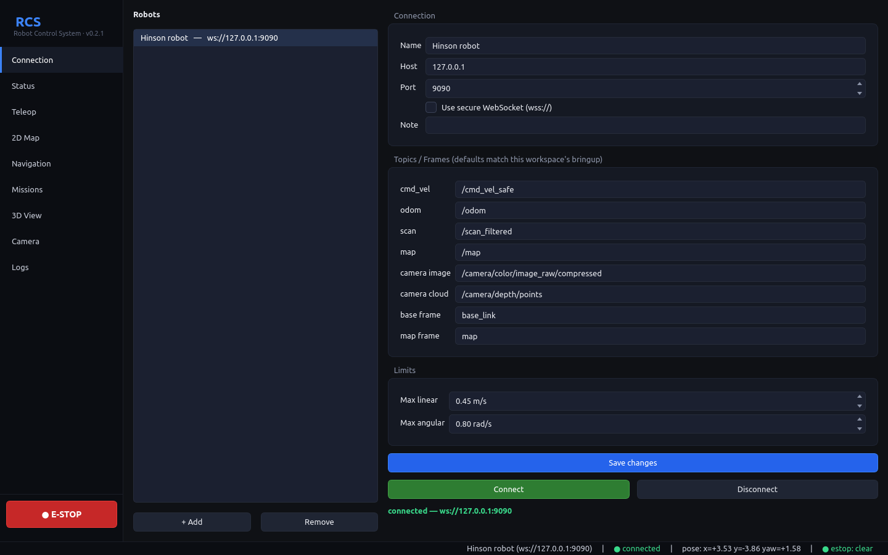
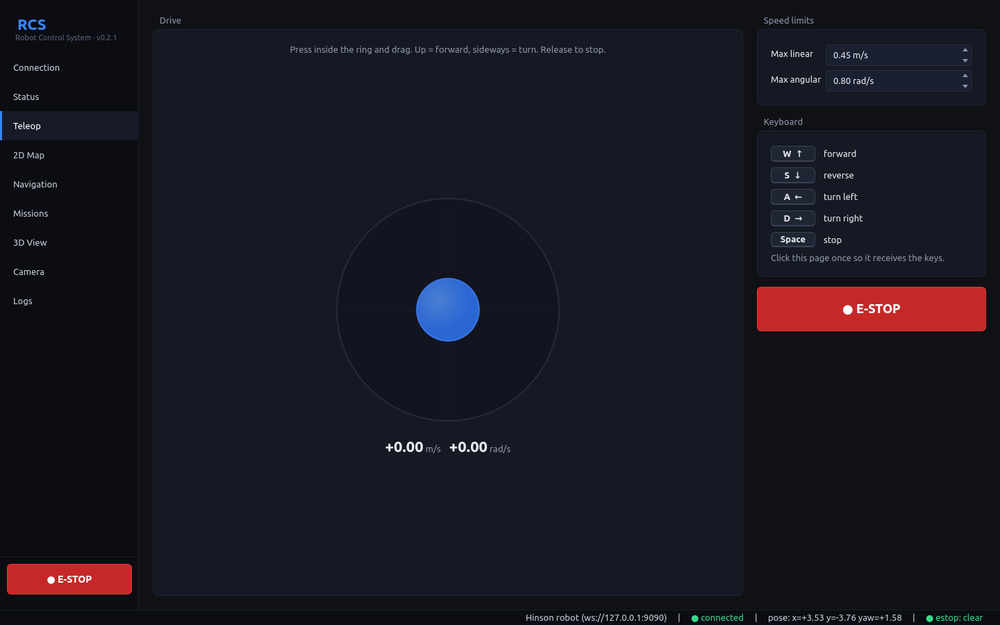
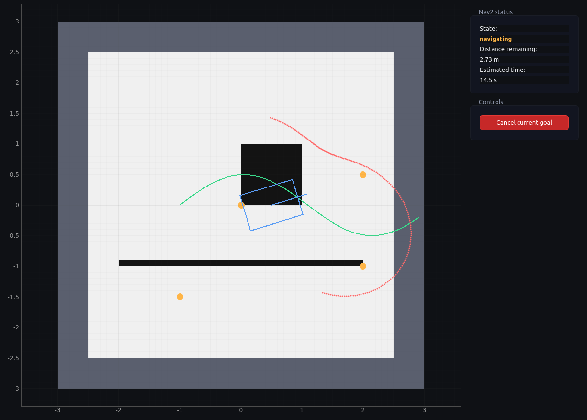
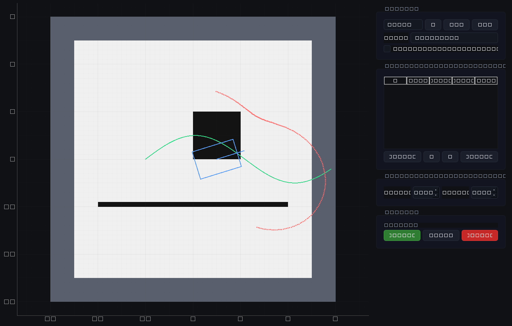
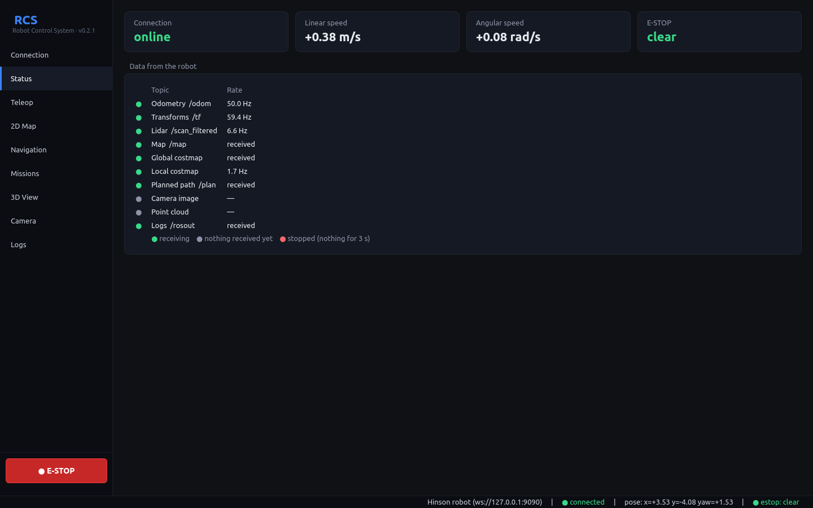
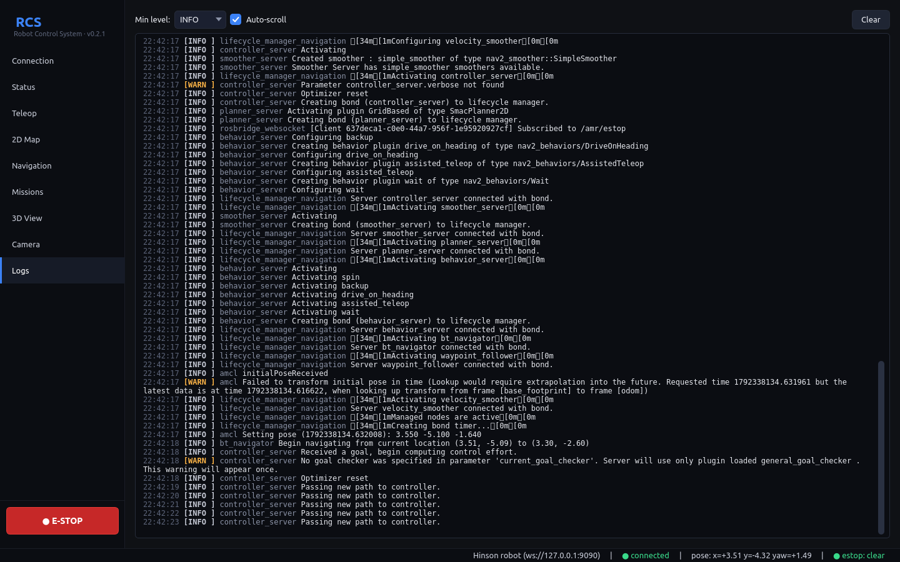

# RCS User Guide

RCS (Robot Control System) is a desktop app for operating Hinson-class
differential-drive AMRs: drive them by hand, see the map, lidar and camera,
send navigation goals and run waypoint missions.

It runs on **Windows 10/11** and **Linux (x86-64)**. The operator PC does
**not** need ROS 2 or Python. The app talks to the robot over the network
through `rosbridge_server`, which runs on the robot.

- [1. How it fits together](#1-how-it-fits-together)
- [2. Prepare the robot (one time)](#2-prepare-the-robot-one-time)
- [3. Install the app](#3-install-the-app)
- [4. First connection](#4-first-connection)
- [5. The main window](#5-the-main-window)
- [6. Driving by hand (Teleop)](#6-driving-by-hand-teleop)
- [7. E-STOP](#7-e-stop)
- [8. Map, localization and goals (2D Map)](#8-map-localization-and-goals-2d-map)
- [9. Navigation page](#9-navigation-page)
- [10. Missions, checkpoints and loop routes](#10-missions-checkpoints-and-loop-routes)
- [11. Status, Camera, 3D View and Logs](#11-status-camera-3d-view-and-logs)
- [12. Several robots](#12-several-robots)
- [13. Settings files and advanced options](#13-settings-files-and-advanced-options)
- [14. Troubleshooting](#14-troubleshooting)

---

## 1. How it fits together

```
 Operator PC (Windows / Linux)                Robot PC (ROS 2 Humble)
 ┌──────────────────────────┐   WebSocket    ┌──────────────────────────────┐
 │ RCS app                  │ ─────────────▶ │ rosbridge_server :9090       │
 │ (no ROS 2 installed)     │ ◀───────────── │   ↕ ROS 2 topics / actions   │
 └──────────────────────────┘   port 9090    │ bringup, Nav2, AMCL, camera… │
                                             └──────────────────────────────┘
```

What the app uses on the robot (defaults, all changeable per robot):

| Purpose | Topic / frame |
|---|---|
| Teleop and E-STOP velocity | `/cmd_vel_safe` (geometry_msgs/Twist) |
| Robot speed | `/odom` |
| Lidar | `/scan_filtered` |
| Map | `/map` |
| Costmaps | `/global_costmap/costmap`, `/local_costmap/costmap` |
| Planned path | `/plan` |
| Goals | `/goal_pose` (PoseStamped), `/navigate_to_pose/_action/status` |
| Initial pose | `/initialpose` |
| Camera | `/camera/color/image_raw/compressed` |
| Point cloud | `/camera/depth/points` |
| Robot logs | `/rosout` |
| E-STOP flag | `/amr/estop` (std_msgs/Bool) |
| Frames | `map`, `odom`, `base_link`, `laser_frame` (from `/tf` and `/tf_static`) |

---

## 2. Prepare the robot (one time)

On the robot PC:

```bash
sudo apt install ros-humble-rosbridge-suite
```

Start it **in the same ROS environment as the robot stack** (same
`RMW_IMPLEMENTATION`, `ROS_DOMAIN_ID` and `CYCLONEDDS_URI`), otherwise it
will not see the robot's topics:

```bash
source /opt/ros/humble/setup.bash
source ~/AMR_WS/first/install/setup.bash
ros2 launch rosbridge_server rosbridge_websocket_launch.xml port:=9090
```

To start it automatically at boot, use the systemd unit in
[`scripts/robot_setup_rosbridge.md`](../scripts/robot_setup_rosbridge.md).

Allow TCP port 9090 from the operator network if a firewall is active:

```bash
sudo ufw allow from 192.168.10.0/24 to any port 9090 proto tcp
```

Optional, for the Camera page: install the compressed image transport so the
camera publishes `/camera/color/image_raw/compressed`:

```bash
sudo apt install ros-humble-compressed-image-transport
```

Then run the robot stack as usual (bringup, and Nav2 when you want to
navigate). RCS does not start or stop ROS nodes on the robot.

**Navigating where there is no saved map yet.** Run SLAM instead of AMCL and
start Nav2 without its map server. The map then grows on the 2D Map page as
the robot drives, and goals work right away (no initial pose needed):

```bash
ros2 launch bringup bringup.launch.py
ros2 launch slam slamtoolbox.launch.xml
ros2 launch nav2_bringup navigation_launch.py \
    params_file:=$(ros2 pkg prefix navigation)/share/navigation/config/nav2_smac_mppi.yml
ros2 run navigation cbf_safety_filter.py --ros-args \
    --params-file $(ros2 pkg prefix navigation)/share/navigation/config/cbf_params.yaml \
    -r cmd_vel_raw:=/cmd_vel -r cmd_vel:=/cmd_vel_safe -r scan:=/scan_filtered -r odom:=/odom
```

This is the same Nav2 and CBF chain as `robot_navigation.launch.py`, with
slam_toolbox in place of AMCL and the map server.

---

## 3. Install the app

Download the build for your OS from the
[Releases page](https://github.com/b4lanc3/AMR-RCS/releases/latest).

**Windows**

1. Download `rcs-windows-x86_64.zip` and unzip it anywhere (for example
   `C:\RCS`).
2. Run `rcs\rcs.exe`. Keep the `_internal` folder next to it.
3. The first time, Windows SmartScreen may warn that the app is from an
   unknown publisher (the build is not code-signed). Click **More info →
   Run anyway**.

`rcs-windows-x86_64-console.zip` is the same app but also opens a console
window with log output. Use it when troubleshooting.

**Linux**

```bash
tar xzf rcs-linux-x86_64.tar.gz
./rcs/rcs
```

On minimal desktop installs Qt may need `libxcb-cursor0`
(`sudo apt install libxcb-cursor0`).

---

## 4. First connection



1. Open the **Connection** page (selected when the app starts).
2. A robot named **Hinson robot** already exists. Select it in the
   **Robots** list.
3. Set **Host** to the robot's IP address (for example `192.168.10.10`) and
   **Port** to `9090`. Leave **Use secure WebSocket** off unless you set up
   TLS on rosbridge.
4. Check the topic names under **Topics / Frames**. The defaults match this
   robot's bringup; change them only if your launch files differ.
5. Click **Save changes**, then **Connect**.

When it works, the text under the buttons turns green
(`connected — ws://…`) and the status bar at the bottom shows
**● connected**. If the robot reboots or Wi-Fi drops, the app keeps
reconnecting every 2 seconds until you click **Disconnect**.

---

## 5. The main window

- **Sidebar (left):** pages: Connection, Status, Teleop, 2D Map,
  Navigation, Missions, 3D View, Camera, Logs. The red **● E-STOP** button
  at the bottom is always visible.
- **Status bar (bottom):** active robot and address, connection state,
  robot pose in the map (`x`, `y`, `yaw` in rad), E-STOP state.

All map views share the same controls:

- **Mouse wheel:** zoom. **Left-drag:** pan.
- **Center on robot** / **Whole map** buttons (top-left of the map). A new
  map opens fitted; later map updates keep your zoom.
- Blue rectangle and line: the robot footprint and its heading.
- Red dots: lidar points. Green line: path planned by Nav2.
- Orange dots: waypoints of the open mission, labeled with their order and name.
- Costmaps (when enabled): magenta = obstacle, blue haze = inflation around it.

---

## 6. Driving by hand (Teleop)



1. Open **Teleop**.
2. Drive with the **joystick**: press inside the ring and drag. Up is
   forward, sideways turns. Release to stop.
3. Or use the **keyboard**, after clicking once on the Teleop page so it
   has focus: **W / ↑** forward, **S / ↓** reverse, **A / ←** turn left,
   **D / →** turn right, **Space** stop.
4. **Speed limits** cap the commands (defaults 0.45 m/s and 0.8 rad/s). The
   live command is shown under the joystick.

Teleop commands go to `/cmd_vel_safe` at 20 Hz while you drive. When you let
go, the app sends zero velocity for 0.3 s and then stops publishing, so it
does not block Nav2. Like the gamepad, teleop bypasses the CBF safety
filter: watch the robot while driving.

---

## 7. E-STOP

Click **● E-STOP** (sidebar or Teleop page). While engaged:

- the current Nav2 goal is canceled and the running mission is stopped,
- the app publishes zero velocity on `/cmd_vel_safe` continuously,
- `/amr/estop` is set to `true` (other consoles listening to it, such as
  the web control center, show it too).

Click the button again to release it. If another console publishes
`/amr/estop`, RCS mirrors that state.

> **Important:** this is a *software* stop over Wi-Fi. Nothing on the robot
> enforces `/amr/estop` today, and another publisher (for example the
> gamepad) can still send commands. If the network drops, the app cannot
> stop the robot. Always keep the robot's hardware E-stop within reach.

---

## 8. Map, localization and goals (2D Map)


The map appears as soon as the robot publishes `/map` (from SLAM, or from
Nav2's map server).

**Localize the robot (set initial pose).** After Nav2 starts, AMCL needs to
know where the robot is. If the robot rectangle is not where the robot
really is, or the Navigation page reports *no response from Nav2*:

1. In **Tools**, choose **Set initial pose**.
2. Click once on the map where the robot is.
3. Click a second time in the direction the robot is facing.

The lidar points should then line up with the walls on the map.

**Send a goal.**

1. In **Tools**, choose **Set goal** (the default).
2. Click the destination, then click again in the direction the robot
   should face when it arrives. A green circle marks the goal.
3. Watch progress on the **Navigation** page.

**Cancel current goal** stops the robot's navigation.

**Add waypoint** mode: each click adds a waypoint to the mission currently
open on the **Missions** page.

**Overlays** turn on or off the lidar points, the planned path, the
waypoints, and the global and local costmaps (shown in red/blue over the
map).

---

## 9. Navigation page



The same map with both costmaps shown, plus the **Nav2 status**:

| State | Meaning |
|---|---|
| goal sent, waiting for Nav2… | the goal was published, Nav2 has not picked it up yet |
| navigating | Nav2 accepted the goal and is driving |
| goal reached | done |
| canceled | canceled by you, the E-STOP, or a mission stop |
| aborted by Nav2 | Nav2 gave up (no path, robot stuck…) |
| no response from Nav2 | nothing happened within 4 s: Nav2 is not running, or the robot is not localized (set the initial pose) |

**Distance remaining** is measured along Nav2's planned path from the
robot's position. **Estimated time** divides it by the robot's current speed
(or the speed limit while the robot is standing still). You can send goals
and cancel from this page too.

---

## 10. Missions, checkpoints and loop routes



A mission is an ordered list of waypoints (checkpoints). The robot drives to
each in turn.

**Create a mission**

1. Open **Missions**. Use **+** to create a mission, **Dup** to copy one,
   **Del** to delete one. Rename it in **Name**.
2. Add waypoints:
   - click on the map of the Missions page (or on the 2D Map page in
     **Add waypoint** mode), or
   - drive the robot somewhere and click **Set here** to add its current
     position.
3. Edit **Name**, **x**, **y** and **yaw°** directly in the table. Reorder
   with **↑ / ↓**, delete with **Remove**.
4. **Default per-waypoint settings** apply to waypoints you add next:
   - **Tolerance:** how close counts as "arrived" (default 0.25 m).
   - **Dwell:** how long to wait at the waypoint before moving on.
5. Tick **Loop route** to start again from the first waypoint after the last
   one, until you stop it.

Missions are saved automatically.

**Run a mission**

- **▶ Play:** start, or continue after a pause.
- **⏸ Pause:** cancel the current goal and keep the position in the list.
- **■ Stop:** cancel and reset to the first waypoint.

The status line shows the current target (`going to pick-A (2/4)`),
arrivals and dwell time.

The robot moves on to the next waypoint once it is within the tolerance and
Nav2 has finished the goal. If Nav2 drops a goal, aborts it, or reports
success while the robot is somewhere else, the app resends the same
waypoint up to 3 times, then stops the mission and says why.

---

## 11. Status, Camera, 3D View and Logs





- **Status:** connection, linear and angular speed (from `/odom`), E-STOP
  state, and the message rate of each topic. A rate of `—` means nothing
  is arriving on that topic: check the robot side.
- **Camera:** live image from `/camera/color/image_raw/compressed` (JPEG),
  limited to about 10 frames/s to spare Wi-Fi. The app only receives it
  while the Camera page is open.
- **3D View:** the camera point cloud (`/camera/depth/points`, about 2
  frames/s, at most 60 000 points) and the robot as a box. The cloud is
  about 1 MB per frame, so the app only receives it while the 3D View page is
  open; on the other pages it does not use the Wi-Fi at all. Drag to orbit,
  wheel to zoom. Needs OpenGL; on PCs without it the page shows a notice.
- **Logs:** messages from `/rosout`. Choose a minimum level, toggle
  auto-scroll, or **Clear**.

---

## 12. Several robots

Each robot is a profile on the **Connection** page.

1. Click **+ Add**, then fill in its name, host and topics. Click **Save
   changes**.
2. To switch robots: select it in the list and click **Connect**.

The app controls **one robot at a time**. Missions are stored per PC, not
per robot; give them clear names if robots share a site.

---

## 13. Settings files and advanced options

| | Linux | Windows |
|---|---|---|
| Robots | `~/.config/RCS/robots.json` | `%APPDATA%\RCS\robots.json` |
| Missions | `~/.config/RCS/missions.json` | `%APPDATA%\RCS\missions.json` |
| App log | `/tmp/rcs.log` | `%TEMP%\rcs.log` |

Some per-robot options are only in `robots.json` (edit while the app is
closed):

| Key | Default | Meaning |
|---|---|---|
| `limits.footprint_half_length` / `_half_width` | 0.45 / 0.30 m | robot rectangle on the maps |
| `limits.laser_offset_x` | 0.40 m | lidar position, used only if `/tf_static` has no `laser_frame` |
| `limits.image_throttle_ms` | 100 | minimum time between camera frames |
| `limits.cloud_throttle_ms` | 500 | minimum time between point clouds |
| `topics.*` | see section 1 | every topic and frame name |

**Command-line options**

```
rcs --host 192.168.10.10:9090 --autoconnect
```

- `--host HOST:PORT` sets the active robot's address.
- `--autoconnect` connects on start.

---

## 14. Troubleshooting

**Cannot connect / keeps reconnecting**
- Is rosbridge running on the robot? From the operator PC,
  `curl -i http://<robot-ip>:9090` should answer (any HTTP reply, e.g.
  `400` or `426`, means it is up). A timeout means it is not running or a
  firewall blocks it.
- Is the host/port right on the Connection page? Did you click **Save
  changes**?

**Connected, but no map, scan or pose**
- Open **Status**: topics with `—` are not arriving.
- rosbridge must run with the same DDS settings as the robot stack
  (section 2). Restart it from a shell where `ros2 topic list` shows the
  robot topics.
- The topic names on the Connection page must match the robot.

**Lidar points do not match the walls**
- The robot is not localized: use **Set initial pose** (section 8).

**Goal shows "no response from Nav2"**
- Start Nav2 on the robot, then set the initial pose. Nav2 only finishes
  starting once AMCL has a pose.

**The robot reaches the goal but faces the wrong way**
- In Nav2's planner settings (`nav2_smac_mppi.yml`, `GridBased`),
  `use_final_approach_orientation` must be `false`. With `true` the planner
  replaces the heading you clicked with the direction it arrives from. This
  workspace ships with `false`.

**Goal stays on "navigating" near the goal, robot shuffles or spins**
- Nav2 cannot close the last few centimetres to the side. The
  workspace uses `xy_goal_tolerance: 0.15` and starts turning to the goal
  heading 0.35 m before the goal (`GoalAngleCritic.threshold_to_consider`),
  which avoids it. Cancel the goal and send it again if it happens.

**Robot does not move with Teleop**
- The driver must listen on `/cmd_vel_safe` (this is the bringup default).
  If bringup was started with `cmd_vel_topic:=/cmd_vel`, change **cmd_vel**
  on the Connection page to `/cmd_vel`.
- Check the E-STOP is released (status bar).

**Camera page stays black**
- The camera is only received while the Camera page is open: give it a
  second after opening the page.
- Install `ros-humble-compressed-image-transport` on the robot and check
  that `/camera/color/image_raw/compressed` exists.

**The app closes unexpectedly**
- Look at the app log (section 13). The console build on Windows shows the
  same output live.
